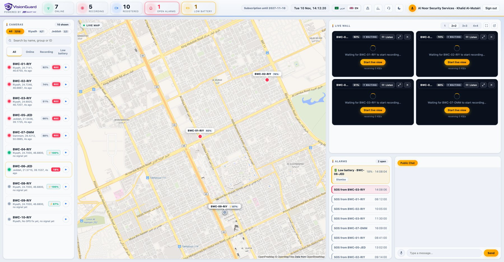
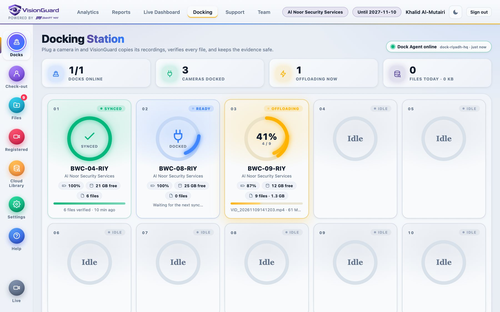
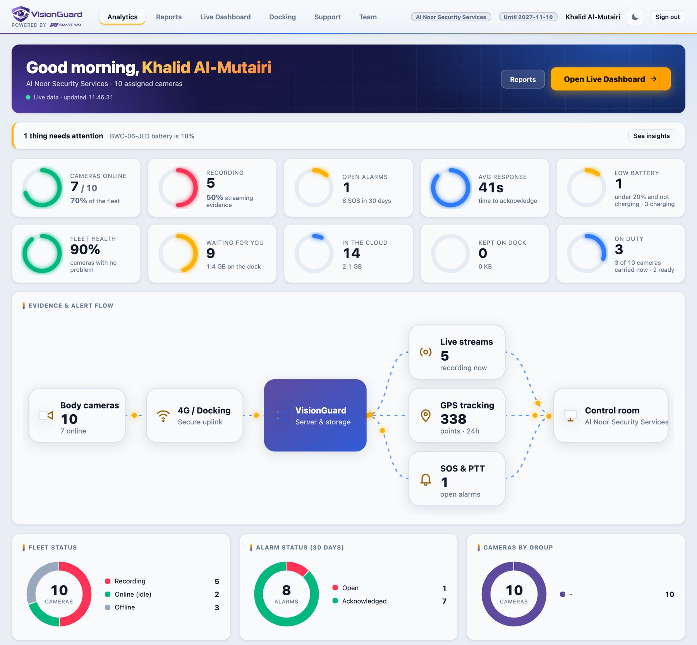

<div align="center">


### Body-worn camera fleet platform by Smart Way Group

Live video, GPS tracking, SOS alarms, push-to-talk and recordings for every camera in the field.
One server, one web dashboard, one mobile app, multi-company from day one.

[](https://github.com/Smart-way-group/VisionGuard_System/actions/workflows/ci.yml)


[Quick start](#quick-start) · [Features](#features) · [Architecture](#architecture) · [Documentation](#documentation) · [Security](#security)

</div>

<p align="center">
  
  <br><sub>Live dashboard (sample data)</sub>
</p>

---

## Features

| | |
|---|---|
| **Live view** | Watch any camera in the browser or the mobile app, a flexible live wall for many cameras at once, and remote start/stop without asking the officer. |
| **SOS and alerts** | Instant SOS alarms with acknowledgement, battery alerts, and push notifications to a locked phone. |
| **GPS and fleet** | Positions on a map, shifts, camera health and a fleet overview. |
| **Push-to-talk** | Voice and text messages between the control room and each camera. |
| **Recordings** | Docking stations offload recordings over USB with SHA-256 verification at three points (camera, dock PC, server). |
| **Analytics and reports** | Fleet analytics, an optional written AI analysis (only aggregated numbers are sent), and PDF reports. |
| **Multi-company** | Each company sees only its own cameras, alarms and recordings. Packages cap cameras and concurrent live streams. |
| **Access control** | Smart Way chooses what each company can use. Each company administrator chooses what each user can see and do. Enforced on the server, not only hidden in the UI. |
| **Employee check-out** | Employees check cameras in and out, with a full audit trail. |
| **Mobile app** | iPhone, iPad and Android app for owners and supervisors, with the same accounts and permissions as the web. |
| **Licensing** | Offline-verifiable signed licences for installations on a customer's own server. |
| **Operations** | Audit log, automatic recording retention, over-the-air camera updates, Docker deployment. |

<p align="center">
  
  
</p>

## Architecture

```
                         socket.io (GPS, SOS, chat, commands)
  Body camera  ─────────────────────────────────────────────►  ┌──────────────────────┐   HTTPS    Web dashboard
  (Flutter, Android)    RTMP video (port 1935)                  │   VisionGuard server │ ◄────────► (browser)
                                                                │   Node.js · SQLite   │
  Docking PC   ── HTTPS upload (verified recordings) ─────────► │   FLV live (8000)    │   HTTPS    Mobile app
  (Dock Agent)                                                  └──────────────────────┘ ◄────────► (iOS · Android)
```

| Path | What it is | Stack |
|---|---|---|
| [`server/`](server) | Server and web dashboard | Node.js 22, Express 5, socket.io, node-media-server, SQLite (`node:sqlite`) |
| [`app/`](app) | Camera app (`com.swg.swg_bwc`) | Flutter, Android |
| [`client/`](client) | Owner and supervisor app | Flutter, iOS and Android |
| [`dock-agent/`](dock-agent) | Offloads recordings at a docking station | Node.js, `adb` |
| [`deploy/`](deploy) | Docker Compose, nginx, systemd, setup script | Docker |
| [`tools/`](tools) | Fleet tools, build publishing, licence signing | PowerShell, shell, Node.js |
| [`docs/`](docs) | Guides and the client brochure | Markdown |

## Quick start

### Server

Requires Node.js 22 or newer.

```bash
cd server
npm ci
cp ../.env.example .env          # then edit the values
BWC_TOKEN=change-me node server.js
```

Open <http://localhost:3000>. On first run an `admin` user is created and its password is printed once, or taken from `ADMIN_PASSWORD`.

Try it without hardware:

```bash
cd server && BWC_TOKEN=change-me node tools/simulate.js 4
```

Run the tests:

```bash
cd server && npm test
```

### Camera app

```bash
cd app
flutter pub get
flutter run --dart-define=BWC_SERVER=http://<server-ip>:3000 \
            --dart-define=BWC_ID=BWC-01 \
            --dart-define=BWC_TOKEN=<token>
```

### Mobile app (owners and supervisors)

```bash
cd client
flutter pub get
flutter run
```

See [docs/MOBILE_APP.md](docs/MOBILE_APP.md) for the API, push notifications and store builds.

### Docking station

```bash
cd dock-agent
DOCK_SERVER=https://<server> DOCK_TOKEN=<token> node agent.js --once
```

## Configuration

The server is configured through environment variables. The full list with comments is in [`.env.example`](.env.example).

| Variable | Purpose |
|---|---|
| `PUBLIC_URL` | Public address that cameras and browsers use |
| `PORT`, `RTMP_PORT`, `FLV_PORT` | Web (3000), camera video in (1935), video to browsers (8000) |
| `BWC_TOKEN` | Shared camera token |
| `STREAM_SECRET` | Signs live-stream URLs. Use a long random value in production |
| `ADMIN_PASSWORD` | First-run admin password (otherwise printed once) |
| `DOCK_TOKEN` | Shared secret for docking stations |
| `DATA_DIR` | Database and recordings location (default `server/data`) |
| `RECORDINGS_RETENTION_DAYS` | Delete offloaded recordings after this many days |

Never commit real values.

## Deployment

Production runs on Docker behind nginx with TLS.

```bash
cd deploy
docker compose -p visionguard -f docker-compose.yml up -d --build
```

Full checklist (DNS, TLS, firewall, systemd alternative): [docs/DEPLOYMENT.md](docs/DEPLOYMENT.md).

## Documentation

| Guide | Topic |
|---|---|
| [docs/GUIDE.md](docs/GUIDE.md) | Operations guide |
| [docs/DEPLOYMENT.md](docs/DEPLOYMENT.md) | Production deployment |
| [docs/MOBILE_APP.md](docs/MOBILE_APP.md) | Mobile app and API |
| [docs/LICENSING.md](docs/LICENSING.md) | Licences for customer-hosted installations |
| [docs/CHECKOUT.md](docs/CHECKOUT.md) | Employee check-out |
| [docs/CAMERA_SIGNING.md](docs/CAMERA_SIGNING.md) | Signing camera builds |
| [dock-agent/README.md](dock-agent/README.md) | Docking station agent |
| [docs/client-brochure](docs/client-brochure) | Client guide (PDF and source) |

## Security

- Sessions use secure cookies or bearer tokens. Passwords are hashed.
- Every API and socket event is checked on the server against the user's company, role and per-user access.
- Live-stream URLs are signed and expire. Pictures and uploads are validated by content, not by file name.
- The audit log records who started a stream, acknowledged an alarm or changed access.

To report a vulnerability, read [SECURITY.md](SECURITY.md). Please do not open a public issue.

## Contributing

Pull requests are welcome from the Smart Way team. Read [CONTRIBUTING.md](CONTRIBUTING.md) first. CI runs the server tests and `flutter analyze` on every pull request.

## License

Proprietary. Copyright © Smart Way Group. All rights reserved.
